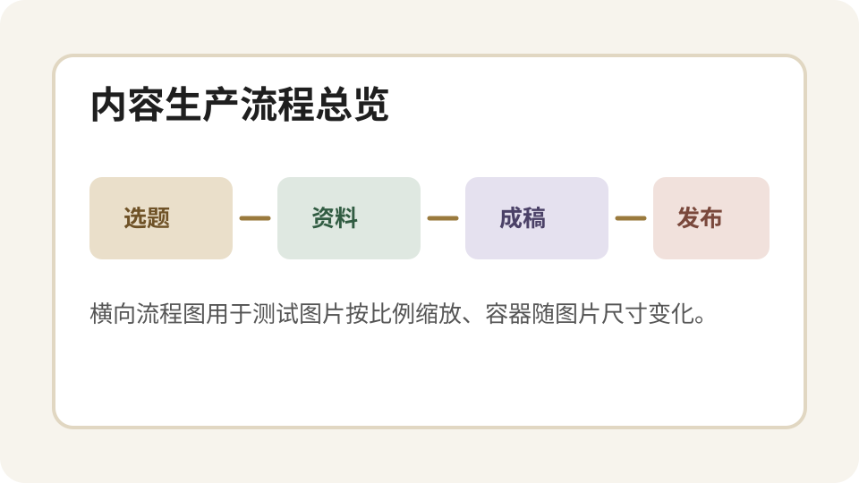
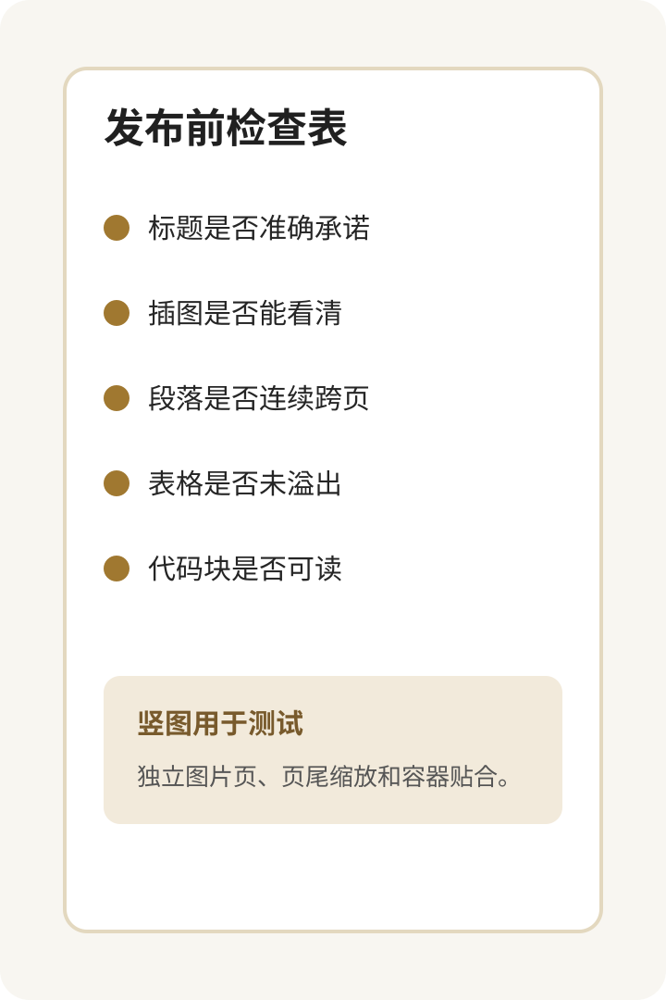

# Markdown 卡片全场景覆盖测试

这是一篇专门用于验证 `markdown-to-cards` 的覆盖型样稿。它包含 **粗体强调**、*斜体语气*、[链接文字](https://example.com)、行内代码 `inline code`，并混合中文、English words 和数字 2026。目标不是写一篇真实文章，而是把排版系统会遇到的结构集中到同一份 Markdown 里。

## 1. 基础段落与跨页

第一类问题是普通段落在页尾的处理。旧逻辑按段落做分页，遇到一个三四行的段落放不下时，会把整段搬到下一页，让上一页底部留下很明显的空白。新的逻辑需要允许普通段落按浏览器实际高度拆分，同时不能漏字、不能重复字，也不能把行内强调、链接或代码打坏。为了覆盖这个情况，这一段故意写得比较长：内容运营系统通常需要把选题、资料、结构、成稿、配图、审核和发布串成稳定流程。如果中间任何一环只能靠人工兜底，整套自动化就会降级为提醒系统。卡片输出在这里不是装饰，而是最终发布物的一部分。它既要好看，也要稳定，还要在多种 Markdown 结构混合出现时保持页尾紧凑。继续补充文字，直到它足够跨过分页边界：当一页只剩两三行空间时，系统应该尽量填入可容纳的文本片段，然后把剩余内容自然接到下一页，而不是整段跳页。

### 1.1 三级标题

三级标题用于验证标题层级和普通正文之间的间距。这里再放一小段正文，检查标题后面的段落不会贴得太近，也不会产生额外大空白。

> 引用块用于测试浅色背景、圆角和段内文字。它通常承载结论、提醒或关键判断，需要明显但不过度抢眼。

## 2. 列表结构

- 无序列表第一项：验证 bullet、缩进和行高。
- 无序列表第二项：这一项故意写长一点，看看换行后是否仍然和 bullet 对齐，避免第二行贴到页面左侧。
- 无序列表第三项：列表后面应该自然回到正文节奏。

1. 有序列表第一项：适合步骤型内容。
2. 有序列表第二项：检查数字编号宽度和中文混排。
3. 有序列表第三项：确保分页时列表块不会破坏整体结构。

## 3. 横向插图

下面是一张横向流程图，用于验证图片容器是否随图片尺寸变化，而不是撑满整行后把图片放在固定大框里。



图片后继续跟一段正文，验证图片加载后的真实高度会参与分页计算。对于截图、流程图、案例图来说，图片不一定需要占满整页；容器应该贴合图片本身，保留适度内边距和圆角即可。这里继续补充几句话，确保图片后面的文字仍然可以紧凑排入当前页或下一页。

---

## 4. 代码块

代码块用于测试深色背景、等宽字体、行高和较长内容的裁切策略。

```js
const pages = paginate(markdownBlocks, {
  width: 720,
  height: 1200,
  splitParagraphs: true,
  keepImagesIntact: true,
});
console.log(`生成 ${pages.length} 张卡片`);
```

## 5. 表格

| 场景 | 期望行为 | 风险 |
|------|----------|------|
| 长段落跨页 | 可拆分且不丢字 | 页尾空白 |
| 横向图片 | 容器随图片宽高变化 | 固定大框 |
| 竖向图片 | 必要时单独成页 | 超出可视区 |
| 表格 | 保持边框和斑马纹 | 文字过密 |

## 6. 竖向插图

下面是一张竖向检查表，用于验证较高图片的缩放和分页策略。



竖图之后继续放正文，确认图片不会把后续内容挤出视口，也不会因为未加载完成导致分页高度为 0。真实发布时，竖图常见于检查表、长截图、清单卡片和移动端页面截图。

## 7. 收尾段落

最后放一个收尾段落，确认所有复杂块之后仍然能回到普通正文排版。这个段落不需要很长，但需要足够覆盖最后一页的页边距、字号、行高和段落底部空白。
