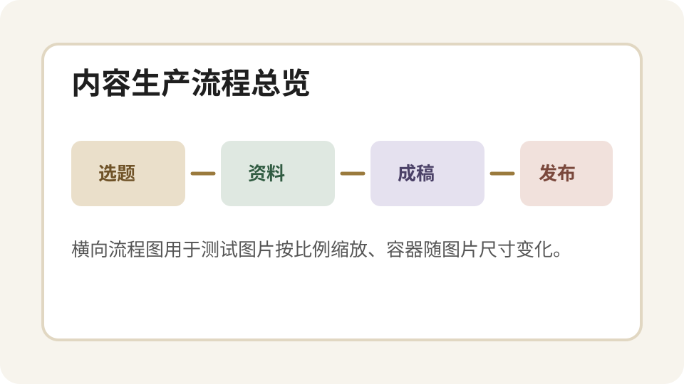
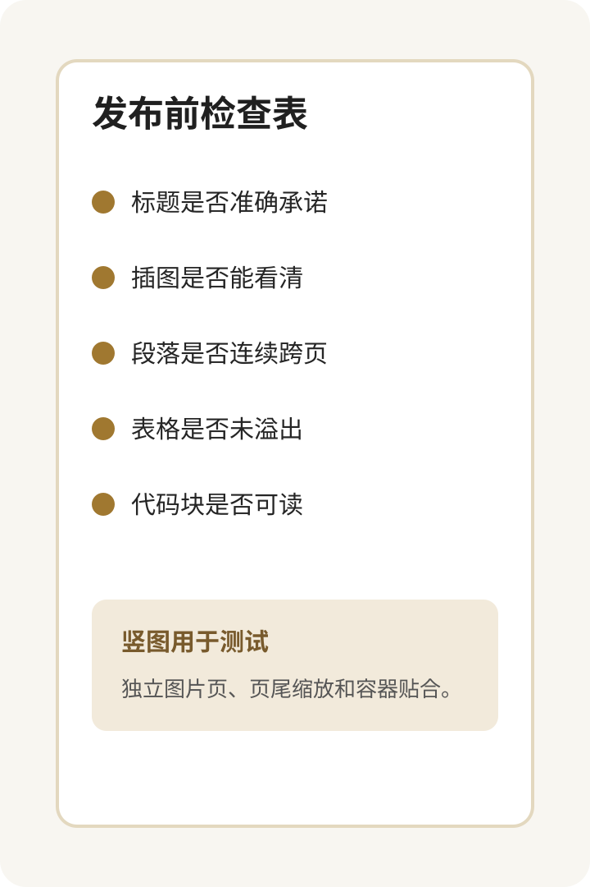

# Stripe 这个原型工具，PM 用得比设计师还多？

设计师这个岗位有个长久的痛点，我觉得大家都懂：Figma 出来的高保真图很漂亮，但研发拿到之后实现出来的东西差了一个维度。于是设计师要反复来回对，花大量时间做“看图说话”，而不是做真正的设计决策。

AI 工具刚出来的时候，很多人以为这个问题要解了。结果呢？你用 v0 生成的界面，是通用的浅蓝色卡片、圆角按钮，像任何一个上世纪的后台管理系统。放到 Stripe 的设计评审里，Owen Williams 给起了一个名字：**blurple slop**。浅紫色的垃圾。

因为 AI 不知道你的设计系统长什么样，它只会按它见过的“最平均的互联网产品”来生成。

## AI 不知道你的品牌，那就教它

理解 blurple slop 要先想清楚 AI 的前端设计能力为什么这么差。不是工具不够聪明，是训练方式本身有个结构性缺陷。写代码解 bug 有正确答案，可以强化学习；设计没有正确答案。

> 你说这个颜色好看，AI 不知道为什么，训练数据里也找不到“为什么 Stripe 的字体间距是这样”这条信息。

Owen 的做法是把答案直接告诉 AI。用 Cursor rules 把 Stripe 的设计系统规则编进去：哪些组件在什么场景下用，颜色变量怎么命名，图表数据怎么格式化。再把所有 React 组件路径告诉 AI，通过 MCP 让它能查到 Stripe 的设计规范文档。

说白了，不是让 AI 自由发挥，而是给它围栏，在围栏里跑。

### 规则不是一句提示词

很多人用 Claude Code 做前端时的直觉是“让 AI 自己发挥一下”。这句话听起来很酷，但在真实团队里几乎一定会翻车。因为团队需要的不是一次惊喜，而是稳定复现。

更稳的方式是把上下文拆成几类：

1. `brand/`：颜色、字体、间距、语气；
2. `components/`：按钮、表单、导航、图表等组件入口；
3. `patterns/`：常见页面结构和交互范式；
4. `reviews/`：设计评审里最常见的扣分项；
5. `examples/`：已经通过评审的真实页面。

这些内容看起来琐碎，但它们决定了 AI 生成的是“能看一眼的 demo”，还是“团队真的愿意拿去讨论的原型”。

## Protodash 的工作流

最近在 Lenny's Newsletter 的播客里，Owen 分享了他是怎么解决这个问题的。他用 Claude Code 和 Cursor，自己 vibe coding 出了一个叫 Protodash 的内部工具，让设计师或 PM 打开浏览器就能生成完全符合 Stripe 设计语言的可交互原型，两分钟，不用写代码。

下面这张流程图不是 Stripe 的原图，而是把这个工作流抽象成一个最小版本，用来验证横向插图在正文里的排版：图片应该按自身比例居中，不应该被一个固定大容器强行撑满整行。



图片之后继续放正文，是为了确认插图不会破坏页面节奏。真实发布时，截图、流程图和案例图经常夹在正文中间；它们要自然占位，也要给后面的段落留出正常的阅读距离。

## “Demo，不要备忘录”

把设计系统喂给 AI 只是第一步。让我觉得这件事有意思的，是它改变了 Stripe 的设计评审文化。

过去的设计评审：设计师出一个 Figma，写文档说明设计意图，然后在会议里对着静态图讲半天。Owen 把这个流程砍掉了。因为现在两分钟就能生成一个真实运行的可交互原型，他的要求变成了：**“Demo，不要备忘录。”**

要提出一个设计方案？拿能点的东西来。要对比两个方向？生成两个 variant 在同一界面里切换，看哪个更对。讨论完全不同了，你在评审一个活的东西，不是想象一张会动的静图。

| 评审对象 | 过去的做法 | Protodash 之后 |
|----------|------------|----------------|
| 设计方向 | 看静态稿和说明文档 | 直接打开可交互 demo |
| 方案对比 | 靠会议讨论想象差异 | 生成两个 variant 来回切 |
| 评审记录 | Figma 评论和文档分散 | AI annotation 整理成记录 |
| PM 参与 | 写需求，等设计产出 | 直接生成可讨论原型 |

表格不是为了显得正式，而是为了让对比关系更清楚。对内容卡片来说，表格也是一个高风险组件：列宽、边框、字号和分页都容易出问题，所以这个测试稿必须保留。

## PM 成了最大的意外受益者

Owen 说，Protodash 推出之后，用得最积极的不是设计师，而是 PM。

这个结果我觉得挺合理，但很多人没预料到。以前原型是设计师的活，PM 负责写需求和验收，两件事之间有一堵墙。但当工具的门槛低到“用自然语言说你想要什么”，这堵墙就没意义了。

PM 开始绕过“写文档让设计师做图”这一步，直接把产品思路生成成可以 demo 给工程师看的东西。

```js
const prototype = await protodash.create({
  prompt: "生成一个 Stripe 风格的订阅管理页面",
  designSystem: "stripe-internal",
  components: [
    "Table",
    "Button",
    "MetricCard",
    "EmptyState",
  ],
  reviewMode: true,
});

await prototype.openInBrowser();
```

这段代码只是示意，但它表达了核心变化：过去 PM 输出的是需求文档，现在 PM 可以输出一个能跑的东西。工程师接到的也不再是一段抽象描述，而是一个可以拆解、重构和生产化的原型。

### 产品经理真正需要补的能力

我自己一直在讲，产品经理转型 AI 时代，真正的竞争力是能 build。这里的 build 不是说每个 PM 都要变成全职工程师，而是能把一个 idea 做到 60-70% 的可交互状态，剩下的稳定性、性能和架构再交给工程团队收口。

往外看一眼：现在硅谷一批 CEO 战略性地闭关 build 产品，产品、设计、研发三个角色正在同一个人身上合并。会计、财务这些业务专家动起手来，连传统 PM 的活都能干，因为他们懂业务场景，AI 给他们补上了代码能力。

## 内部工具的不对称优势

Owen 提到一点我很认同：内部工具不需要 production-grade，只需要 fit-for-purpose。

Protodash 跑在 dev boxes 上，不是正式上线的 SaaS。它会出 bug，原型有时候有奇怪的渲染问题。但这些都不妨碍它成为 Stripe 内部评审流程的基础设施。

> 先让 AI 把活干了，再想怎么封装成产品。不要一开始就追求完美架构，先有一个能跑的东西，改变就开始发生。

长图文发布前，我一般会给这类内容补一张检查清单。它可以是截图、表单、移动端页面，也可以是专门为文章做的辅助图。这个测试稿保留一张竖向图片，用来验证图片最大高度、居中和后续文字衔接。



这类竖图通常来自移动端截图、清单卡片或表单页面。排版时要特别注意：如果图片过高，应该缩放或独立成页，而不是把后续内容挤出可视区域。

## 边界比自由更有用

为什么同样的 AI 工具，有人做出 blurple slop，有人做出 Protodash？

差距不在工具，在有没有把自己的上下文给够 AI。Stripe 的做法是把设计系统编进规则文件，把组件库路径告诉 AI，让它在有边界的范围内生成。用通用 AI 工具直接生成，当然什么都出来了。

这个逻辑哪里都成立。上下文太少、约束太模糊，输出质量就是那样。这也是为什么内部工具比 off-the-shelf 工具更适合很多公司。通用工具不知道你的设计系统，不知道你的流程规范，用越久越感受到这种错位。自建的工具天生在你的 context 里长大，这是它的不对称优势。

---

## 结论

Protodash 这个案例真正值得看的，不是 Stripe 又做了一个内部工具，而是它把一个长期存在的协作问题改了：从“用文档描述一个产品”，变成“直接拿一个能点的东西讨论”。

如果你只把 AI 当成写代码的助手，它当然只是一个效率工具。但如果你把设计系统、组件库、评审标准和业务流程都变成 AI 能读取的上下文，它就会变成团队的原型基础设施。

这也是我觉得 PM 最该关注的地方：未来不是谁会写更多需求文档，而是谁能更快把想法变成可验证的 demo。
